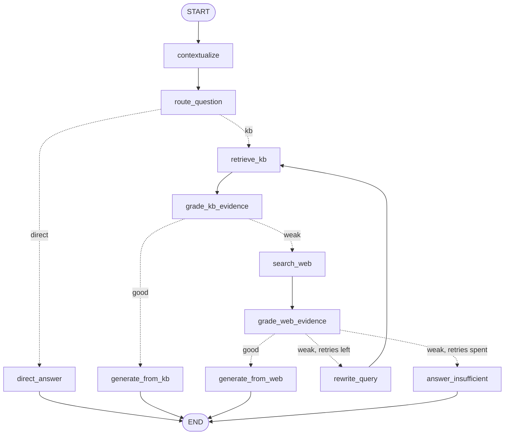

# Enterprise HR Policy and Employee Support — Agentic RAG Copilot

An internal HR assistant built as an **agentic** retrieval-augmented generation system: instead of
answering from a single retrieval pass, it scores what it retrieves, rejects out-of-domain matches,
and falls back to query rewriting and web search rather than hallucinate policy.

Around that sits the part that makes it a product rather than a demo — guardrails, a semantic cache,
model routing, loop budgets, a tool registry, a supervisor-worker team, an approval queue and a
cost model — and the part that makes it something a stranger can try: it answers with **no API keys
at all**, from BM25 over the policy documents on disk.

Built as a Forward Deployed Engineer (FDE) style project — taking a RAG workflow from notebook
experiment to a measured, reproducible system with the failure modes written down.

---

## Try it

**→ [hr-policy-copilot.vercel.app](https://hr-policy-copilot.vercel.app)**

It runs there with **no provider credentials at all**, and that is the interesting part rather than
a limitation. With no Pinecone key and no chat model, `effective_retrieval_mode` resolves to
`lexical`: BM25 over the eleven policy documents on disk, then the most relevant sentences stitched
together and labelled as what they are. No model wrote them, so nothing can have invented a policy
number — which makes the worst-case answer the most trustworthy one in the system.

`/health` on that deployment reports `degraded` and names the three missing keys, and the console
says so in the top bar. That is the capability reporting working, not a broken deploy: a public
demo with no vector database is not faulty, it is lexical.

Ask it *"How many days of paid time off do full-time employees get?"* and it answers from
`leave-and-time-off.md` in about 10 ms. Ask it *"What is the capital of France?"* and it tells you
it has nothing, which is the behaviour the whole retrieval gate exists to produce.

**For written answers, paste your own OpenAI or Groq key into Settings.** Your questions are then
answered on your account at whatever model you pick, with no shared-key rate limit. The key builds
one chat client, is pooled by a hash of itself, and never reaches the audit log, a span, a log
line, the vector index or the web search — only the chat model. `ALLOW_BYOK=0` turns the whole
feature off for an internal deployment.

What is live there and what is not:

| | On the demo | Why |
|---|---|---|
| Retrieval | BM25, lexical | no Pinecone key, and a serverless function cannot ship torch |
| Answers | extractive, or your key | no chat model is configured server-side |
| Audit log | ephemeral | `/tmp` is the only writable path and does not survive a redeploy |
| Rate limit | 6/min, per instance | a token bucket in process memory; see [docs/production.md](docs/production.md) |
| Admin surface | configured, key withheld | `/api/audit` answers 401, `/docs` is withheld in production |

The container is where this belongs; [docs/deploy-vercel.md](docs/deploy-vercel.md) is candid about
which of those are platform limits and which have fixes.

---

## What was built

Starting from a working retrieval stack and an 11-node LangGraph agent, this adds the layers that
separate a demo from something you could put in front of employees. Each links to the document that
carries its reasoning and its measurements.

**Retrieval** — [docs/rag.md](docs/rag.md)
- BM25 implemented directly (not a dependency), fused with the dense retriever by **reciprocal rank
  fusion** — by *rank*, because a cosine score and a BM25 score are not on the same scale.
- **Re-ranking** over a wider candidate list, because retrieval ranks by similarity to the question
  and that is not the same as answering it: a wrong-source chunk scored **0.521** against a
  weakest-correct of **0.171**.
- A **lexical mode that needs no keys at all**, which is both the serverless fallback and genuinely
  better at exact-term questions — a form number, "IJP", "Form 16".
- Few-shot grading behind a switch, deliberately **off**, because the shipped prompt is what the
  0.15 gate and the 21/21 labelled set were measured against.

**Multi-agent** — [docs/multi-agent.md](docs/multi-agent.md)
- A **supervisor-worker team** as a compiled graph: six specialists mapped onto documents that
  actually exist, with handoff records, escalation to a human, and a shared scratchpad.
- The hard rules — never the same worker twice, private documents before the web, a forced stop at
  the handoff ceiling — live in the **branch functions, not the prompt**. A prompt instruction is a
  suggestion.
- A **split decision** whose safe default is *don't*: a wrongly split question costs latency, a
  wrongly merged one costs the employee half their answer and still reads as complete.

**Agent patterns** — [docs/agent-patterns.md](docs/agent-patterns.md)
- A **minimal ReAct loop** over a **tool registry** with eleven ordered steps per call: validation,
  authorization, approval, idempotency, timeout, retry, backoff, charge.
- **Parallel tool calls** returned in *call* order rather than completion order, because the
  observations go into a prompt.
- **Short-term and long-term memory**, the latter over a closed key set — free-text keys would make
  it a profile store.

**Production** — [docs/production.md](docs/production.md)
- **Semantic caching** with a deliberately high threshold and short TTL; the PTO/contractor pair is
  the worked example of why a loose one would be dangerous here.
- **Model routing**: complexity → tier → model, measured against a labelled set (14/14, previously
  10/13 — it had been wrong in *both* directions at once).
- **Streaming** over SSE, and **cost projection** reported honestly as a projection, never an
  invoice.
- **In-process span tracing** rendered in the console, with payloads redacted by default.

**Safety** — [docs/safety.md](docs/safety.md)
- **Input and output guards** with PII redaction across 13 identifier types, applied once at the
  edge before a question reaches a provider, the vector index or the audit log.
- Prompt injection is **flagged and neutralised, not refused** — and the document says plainly what
  regex PII detection does *not* catch.
- **Three roles over one deny-by-default table**, so HR can work the approval queue without gaining
  the ability to read every employee's question.
- A **human-in-the-loop approval queue** with single-shot decisions and expiry as a distinct
  outcome from rejection.

**Reliability** — [docs/reliability.md](docs/reliability.md)
- **Six budget ceilings** per run, where a budget is a *stopping condition* and not an error: the
  answer comes back partial and says so.
- A **degradation ladder** — Pinecone down falls to BM25, a failed generation falls to the retrieved
  text rather than an apology, no model at all still answers.
- An **idempotency ledger** with an atomic claim and a stall window, so one crash does not block
  retries for a day.

**Surfaces**
- A rebuilt **console**: ask, dashboard, agents, pipeline, knowledge, approvals, audit, settings —
  no framework, no build step, and nothing untrusted ever assigned to `innerHTML`.
- **652 offline tests**, zero lint findings, and a suite that passes with `.env` moved aside.

### Bugs this work surfaced

Worth listing, because each was silent and each has a test now:

- The **complexity classifier was inverted** — it marked *"How many days of PTO do I get?"* complex
  while marking a contractor's mid-notice parental leave question standard, routing the commonest
  question to the deep model and the supervisor.
- `FEWSHOT_GRADING`, the **semantic cache**, and `AUDIT_STORES_REDACTED` were all **switches that
  did nothing** — the cache defines `__len__`, so an empty cache was falsy and `if self.cache`
  skipped both the lookup and the store.
- The **extractive fallback for a failed generation was never wired**: generation fails without
  raising, so the rescue never fired.
- **Supervisor escalations reached nobody** — they went to the scratchpad, never the approval queue.
- A **phone number at the end of a sentence was not redacted** (a trailing-dot lookahead), and the
  router and graders recorded zero-duration events, so the latency breakdown under-reported model
  time.

---

## Documentation

Six topic documents, each grounded in the code and carrying the measurements behind its claims.

| Document | Covers |
|---|---|
| [docs/rag.md](docs/rag.md) | Chunking, embeddings, vector search, hybrid search, re-ranking, few-shot examples, RAG vs fine-tuning vs long context, knowledge base sizing |
| [docs/multi-agent.md](docs/multi-agent.md) | Supervisor-worker, handoff and escalation, shared state, when to split |
| [docs/production.md](docs/production.md) | Model routing, semantic caching, streaming and latency, horizontal scaling, cost projection |
| [docs/safety.md](docs/safety.md) | Input filtering, output filtering and PII, authorization, human-in-the-loop |
| [docs/reliability.md](docs/reliability.md) | Loop budgets, graceful degradation and fallbacks, idempotency |
| [docs/agent-patterns.md](docs/agent-patterns.md) | ReAct loop, tool registry, error handling, memory, retries and timeouts, budgets, approval, tracing, routing, caching, parallel tools |
| [docs/deploy-vercel.md](docs/deploy-vercel.md) | Deploying the public demo, and what does not work on a serverless platform |

The reference brief and target architecture this is built against are also in
[docs/](docs/): `Enterprise_HR_Agentic_RAG_Problem_Statement_DigitalOcean.pdf` and
`architecture.png`.

---

## Status

### The retrieval and agent core

| Layer | State |
|---|---|
| Public web ingestion → Pinecone | Implemented, verified end to end |
| Private (internal) knowledge base → Pinecone | Implemented, verified end to end |
| Namespace isolation between the two corpora | Implemented |
| Retrieval + out-of-domain gating | Implemented, evaluated on 12 questions, re-verified after the KB grew |
| Private KB covering all nine areas the brief names | 11 documents, 31 chunks |
| Hybrid retrieval — BM25 + dense, fused with RRF, then re-ranked | Implemented, degrades to either side alone |
| Lexical-only mode — BM25 on disk, no keys, no network | Implemented, verified with every credential removed |
| Groq LLM client (`openai/gpt-oss-20b`, temperature 0) | Implemented, live call verified |
| Tavily web-search client | Implemented, live call verified |
| Structured routing + evidence grading | Implemented, 21/21 on a labelled set |
| LangGraph agent (11 nodes: contextualise → route → grade → rewrite → fallback → answer) | Implemented, all paths verified |
| Supervisor-worker team (6 specialists, handoff, escalation, shared scratchpad) | Implemented, compiled graph asserted against its documented edge set |
| ReAct loop over a tool registry | Implemented |
| Extractive answering with no language model | Implemented, verified keyless end to end |
| Multi-format ingestion (Markdown, TXT, PDF, DOCX) | Implemented |
| Metadata filtering (`department`, `doc_type`) | Implemented |

### The production layers around it

| Layer | State |
|---|---|
| Input guard — injection neutralised, secrets caught, unsafe refused | Implemented |
| PII detection and redaction before a question travels | Implemented, 13 identifier types |
| Output guard — echoed PII redacted, credentials blocked, ungrounded figures flagged | Implemented |
| Role-based authorization — employee / HR / admin, deny-by-default table | Implemented |
| Human-in-the-loop approval queue, single-shot decisions, expiry | Implemented |
| Loop budgets — steps, tool calls, model calls, tokens, wall clock, cost | Implemented |
| Idempotency ledger with an atomic claim and a stall window | Implemented |
| Semantic cache — exact then embedding, high threshold, short TTL | Implemented, dropped on ingest |
| Model routing — heuristic complexity → tier → model | Implemented, 14/14 on a labelled set |
| Cost projection from published list prices | Implemented, reported as a projection |
| In-process span tracing, payload-redacted by default | Implemented, rendered in the console |
| Streaming answers over SSE | Implemented, same answer as the posted endpoint |
| Bring your own key — per-caller provider credentials, pooled, never stored | Implemented |
| Rate limiting on the deployment's own key | Implemented, honest about being per-process |
| Test suite — 652 tests, no network, no credentials | Implemented |
| Lint gate — `ruff` over `app/`, `scripts/`, `tests/` | Implemented, passes with zero findings |
| LangSmith tracing, redacted by default | Implemented, verified against the live service |
| Swappable providers — Groq/OpenAI LLM, local/OpenAI embeddings | Implemented, both paths verified live |

### The surfaces

| Layer | State |
|---|---|
| FastAPI service | `/health`, `/api/chat`, `/api/chat/stream`, `/api/config`, `/api/graph`, `/api/tools`, `/api/metrics`, `/api/scratchpad`, `/api/approvals`, `/api/upload`, `/api/audit` |
| SQLite audit layer (question, answer, decisions, trace, spans, model, tokens, cost, latency) | Implemented |
| Browser console — ask, dashboard, agents, pipeline, knowledge, approvals, audit, settings | Implemented |
| Docker image + compose — non-root, CPU-only torch, model baked in | Implemented, built and run |
| Vercel deployment — slim bundle, keyless demo mode | Implemented, [documented](docs/deploy-vercel.md) |
| DigitalOcean deployment | Not yet built |
| Feedback capture | Not yet built |

The agent runs end to end behind an HTTP surface and a browser console: employees ask at `/`, HR
staff upload policy and work the approval queue through the same UI, and every answered question is
written to a SQLite audit log the console renders. What remains is feedback capture and the
DigitalOcean deployment the brief names.

## What was built, and what it achieved

Six pieces of work, each as Situation → Task → Action → Result. Every figure is measured — the
12-question retrieval benchmark, the labelled routing and grading set, the corpus counts, and the
test and lint gates — and each is derived below in its own section.

These are also rendered in the console's **Overview** view, so a reader who opens the running app
sees the same claims as a reader who opens this file. **Change a number here and change it in
[templates/index.html](templates/index.html) in the same commit** — that page is the one written for
someone who cannot check it against the code.

---

**1. Stopped the system answering from memory**

- **S** — A single-pass RAG chatbot returns its top matches whatever it is asked, so a question the
  handbook does not cover still produces a fluent, sourceless answer about company policy.
- **T** — Make "internal policy does not cover this" a real, reachable outcome rather than a
  fallback nobody wired up.
- **A** — Built an 11-node LangGraph agent that grades retrieved evidence with a constrained LLM
  decision before generating, then rewrites the query and retries, then falls back to cited web
  search, then declines — each an explicit branch in the graph.
- **R** — **21 of 21 decisions correct** on a labelled set (router 16/16, grader 7/7). Every answer
  now resolves to a cited internal document, a cited URL, or an explicit refusal — and the console
  shows which.

**2. Calibrated the relevance gate from measurement, not intuition**

- **S** — Vector search always returns its top results, so an unrelated question such as *"what is
  the capital of France?"* still retrieves confident-looking HR chunks.
- **T** — Find a threshold that rejects out-of-domain questions without discarding real ones, and be
  able to show why that number and not another.
- **A** — Ran a 12-question benchmark across the corpus and measured similarity separately for
  correct-source, wrong-source and out-of-domain chunks, then placed the gate inside the observed
  gap.
- **R** — Out-of-domain peaked at **0.099** against a weakest correct chunk of **0.171**, so a gate
  at **0.15** drops every out-of-domain result while losing no in-domain one. Re-measured after the
  corpus grew from 6 documents to 11: out-of-domain fell to **0.078**, so the calibration still
  holds.

**3. Made the knowledge base safe for HR to update**

- **S** — Policy arrives as Word files and PDFs and it changes; a superseded document left in the
  index keeps answering questions with withdrawn policy.
- **T** — One ingestion path for every format, reconciling the search index against what is actually
  approved today.
- **A** — Built a multi-format loader covering Markdown, TXT, PDF and DOCX including table content,
  with heading-aware chunking, deterministic chunk IDs, and orphan pruning on every corpus rebuild.
- **R** — **11 documents indexed as 31 chunks**, covering all **9** HR areas the brief names. An
  edited policy updates in place instead of duplicating, and a deleted one leaves the index. HR
  staff add documents through the console, admin-gated.

**4. Made every answer auditable without leaking employee questions**

- **S** — *"What did it tell someone about the notice period in March?"* is a question the business
  will eventually have to answer — and because the agent is not deterministic, re-running the
  question later proves nothing.
- **T** — Record the decision trail at the moment of answering, while keeping HR questions inside
  the deployment.
- **A** — Added a SQLite audit log capturing the question, answer, route, both grades, citations,
  the full node trace and latency, behind an admin-only API. Put third-party tracing behind an
  explicit switch that is off by default and payload-redacted when on.
- **R** — Every answer is reconstructable from the log, with a grounded-answer rate that exposes a
  broken ingest or an exhausted quota from outside. Under default settings **no employee question
  leaves the deployment**.

**5. Made a provider outage cost one source, not the answer**

- **S** — The agent depends on three external services. Any one failing mid-question would abort the
  whole run and return an error to the employee.
- **T** — Degrade gracefully rather than fail, and prove it without spending a paid API call to do
  so.
- **A** — Wrapped every network call in a guard that converts a failure into a recorded fallback — a
  retrieval outage becomes "no evidence", which routes to web search — and confined provider
  response shapes to one adapter module. Every client is injected, so the suite runs against fakes.
- **R** — **652 tests pass offline with no credentials** and **ruff reports zero findings**. An
  outage downgrades to an alternative source and is labelled degraded in the trace, so it is never
  mistaken for a genuine gap in policy.

**6. Made the admin surface fail closed**

- **S** — Whoever can upload to the knowledge base can change what company policy appears to say,
  and the audit log holds every employee's question and the answer they were given.
- **T** — Ensure a misconfiguration turns the admin surface *off*, never open.
- **A** — Gated upload and audit behind an API key with no default value and a constant-time
  comparison, enforced an upload size cap while the file streams, sanitised uploaded filenames, held
  secrets in redacting types, and kept provider error text out of every HTTP response.
- **R** — With no key configured the admin endpoints refuse **every** request rather than accepting
  any. Production additionally withholds the API documentation and refuses to start without a key.

---

## The agent graph

Eleven nodes, wired in [app/agent/graph.py](app/agent/graph.py) over bodies in
[app/agent/nodes.py](app/agent/nodes.py). The graph never answers from model memory: every
answer is traceable to internal policy, to cited web results, or to an explicit admission that
neither had the evidence.



Dotted arrows are branches taken on a structured decision. Regenerate the diagram straight from
the compiled graph with `python scripts/render_graph.py`, which writes
[docs/agent-graph.md](docs/agent-graph.md). `test_the_compiled_graph_matches_the_documented_design`
asserts the compiled edge set equals this design exactly, so the picture cannot drift from the
code.

**A follow-up is resolved before anything retrieves.** `contextualize` turns *"what about
contractors?"* into a question that stands on its own, because the bare pronoun retrieves nothing.
It runs on every question but only costs an LLM call when there is history — a first question is
already standalone, and paying to be told so would tax the common case. Verified live:

```
Q: "what about contractors?"   (after a question about dental waiting periods)
  Contextualiser: resolved to "What about dental waiting periods for contractors?"
  KB Retriever: 4 chunk(s) for "What about dental waiting periods for contractors?"
```

The answer carries a `read as:` chip whenever this happened, because it is the one thing a reader
cannot reconstruct from their own message.

**A rewrite loops back to the KB, not to web search.** A weak retrieval is usually a vocabulary
mismatch between how an employee phrases a question and how policy is written, so the rewritten
query deserves another look at internal policy before falling back to public sources. `retry_count`
bounds the loop at `MAX_RETRIES = 1`.

**Every node records what it did.** `AgentState.trace` collects one entry per node, in the order the
graph ran them, and comes back on `AnswerResult.trace` — the execution trace the brief asks the UI
to show, available before the UI exists. It is a reducer key (`Annotated[list[str], add]`) rather
than a plain list because a plain `TypedDict` key is *replaced* by each node's return, which would
leave only the final step and erase the rewrite loop's history. Degraded calls are recorded too: a
Pinecone outage and a genuine absence of policy produce the same answer, and only the trace tells
them apart.

```
TRACE
  1. Router: kb
  2. KB Retriever: 1 chunk(s) for 'How many PTO days do I get?'
  3. KB Grader: weak
  4. Tavily: searching 'How many PTO days do I get?'
  5. Tavily: 101 characters
  6. Web Grader: good
  7. Generate/Web: answered from web_search
```

`citations` sits beside it and behaves the opposite way. `retrieve_kb` writes it in the same update
as `kb_docs`, from the same chunks, and it is *replaced* rather than accumulated — a rewrite loops
back through retrieval, and carrying the first attempt's sources forward would cite documents the
answer no longer rests on.

Verified live, all four terminal paths plus the loop:

| Path | Result |
|---|---|
| `"hi there"` | `direct` |
| `"How many PTO days do I get per year?"` | `private_kb`, answers 20 days, cites the source file |
| `"Who won the football World Cup in 2022?"` | KB returns 0 chunks → `web_search`, flagged as public info, not policy |
| KB and web both empty (injected) | one rewrite, then `insufficient_evidence`; loop terminates |
| KB empty then populated (injected) | recovers to `private_kb` after the rewrite |

---

## The console

A single page at `/`, served by the same application that serves the API — so it is same-origin and
this deployment carries no CORS middleware. No framework and no build step: one Jinja2 template, one
stylesheet, one script, which is what lets the target architecture's Nginx container serve
`static/` unchanged.

Four views behind a rail: **Ask**, **Overview**, **Ingest** and **Audit**. The last two only appear
when an admin key is configured — a courtesy, not the gate; `require_admin` refuses on every request
regardless.

**Ask** is the chat, with an inspector beside it that answers the question *"why should I believe
this?"* three ways:

- **Workflow** — the eleven-node graph, with the path this answer actually took lit up and the edges
  animated in the order they were traversed. The highlight is derived from the trace, so it cannot
  disagree with what ran. Underneath it, the route, both grades, the chunk count, the rewrite count
  and the round-trip latency.
- **Trace** — one entry per node in execution order, colour-coded: green for a `good` grade, amber
  for `weak`, red for a degraded call. A run that fell back to the web because Pinecone was down
  looks identical to one that fell back because the evidence was weak — the trace is the only place
  that says which.
- **Evidence** — the cited documents, with department and type, and any external URLs kept visually
  distinct from internal policy.

The answer itself carries a badge naming its provenance in plain language — *internal policy*,
*public web*, *no reliable evidence* — plus each grade and a chip per cited file.

**Overview** is the project brief for a reader who will not open the code: the problem, the
solution architecture as four stages, six pieces of work written as Situation → Task → Action →
Result, and the technology behind each layer. **Every figure on it is a measured one** — the
12-question retrieval benchmark, the labelled routing and grading set, the corpus counts, and the
test and lint gates — and each is stated in this README as well. Change a number in one place and
change it in the other: a stale claim there is worse than no page at all, because it is the one
screen read by someone who cannot check it against the code.

**Ingest** is a dropzone over `POST /api/upload`. A finished upload prints a receipt: file,
department, namespace, chunk count and how many vectors the namespace now holds.

**Audit** renders `/api/audit` and `/api/audit/stats` — the answered-question log with per-source
counts and the grounded rate as a meter.

Both themes are first-class; the toggle swaps a dozen custom properties rather than restyling
anything. Everything animated is decorative and the whole stylesheet stands down under
`prefers-reduced-motion`.

**The console never assigns untrusted content to `innerHTML`.** Answer text comes from an LLM,
citation titles from uploaded documents, audit rows from the database — and the admin reading the
audit log is exactly the session worth stealing. Every dynamic string reaches the page through
`textContent`, and the small markdown renderer *builds* `<strong>` and `<code>` elements instead of
parsing markup, so there is no escaping step that can be forgotten. The admin key lives in
`sessionStorage` (tab-scoped, gone when the tab closes) and travels in the `X-Admin-Key` header,
never in a URL.

---

## The HTTP API

Two audiences, two routers. `/health` is unprefixed and open, because a load balancer polls it and
it has to answer at every environment and without credentials. Everything else is under `/api`, and
everything that can change what the copilot says — or read what it has said — is behind an admin
key.

| Method | Path | Auth | Purpose |
|---|---|---|---|
| `GET` | `/health` | open | liveness, resolved providers, missing secrets by name |
| `POST` | `/api/chat` | open | ask one question; returns the answer, its citations and its trace |
| `POST` | `/api/upload` | `X-Admin-Key` | add one document to the private KB |
| `GET` | `/api/audit` | `X-Admin-Key` | the answered-question log, newest first, paged |
| `GET` | `/api/audit/stats` | `X-Admin-Key` | how questions were resolved, and how often |
| `GET` | `/api/audit/{id}` | `X-Admin-Key` | one answered question in full |

Interactive docs are at `/docs` outside production. In production they are withheld — they
enumerate every route, admin ones included — while `/health` stays open.

```bash
curl -s localhost:8000/api/chat -H 'Content-Type: application/json' \
     -d '{"question":"How many PTO days do I get?"}'
```

```json
{
  "question": "How many PTO days do I get?",
  "answer": "Full-time employees accrue 20 days of paid time off per year ...",
  "route": "kb",
  "source_used": "private_kb",
  "kb_grade": "good",
  "kb_chunks": 2,
  "retry_count": 0,
  "rewritten_query": null,
  "sources": [{"source": "leave-and-time-off.md", "department": "general", ...}],
  "web_urls": [],
  "trace": ["Router: kb", "KB Retriever: 2 chunk(s) for '...'", "KB Grader: good",
            "Generate/KB: answered from private_kb"],
  "audit_id": 41
}
```

**The admin key fails closed.** `ADMIN_API_KEY` defaults to empty, and an empty key means the admin
routes refuse *every* request with 503 — before they look at the header, so an unset key can never
be matched by an absent or empty one. A wrong key is 401. `/health` reports `admin_enabled`, so an
accidentally-off admin surface is visible from outside rather than discovered when someone tries to
upload. Keys are compared with `hmac.compare_digest`; a plain `==` on a secret leaks its length and
prefix through timing.

**No error response carries an exception's text.** A provider failure carries URLs, request ids and
sometimes the offending payload, and this process holds API keys — `detail=str(exc)` is how one of
them reaches a browser. Failures are logged with their traceback and answered with a fixed sentence,
and a test posts a question to a copilot that raises `key=gsk_live_SECRET` to prove neither the key
nor the host comes back.

**Uploads are capped while streaming, not after.** `await file.read()` with no argument materialises
the whole body first, which is a way to exhaust the process before any limit gets to apply.
`MAX_UPLOAD_MB` (10 by default) is enforced a megabyte at a time and a refused upload leaves no
partial file behind. The filename is treated as attacker-controlled text: both separators are
stripped, not just the platform's, because a Windows client posting to a Linux container sends
backslashes that `Path.name` there would keep.

**Every answered question is written to SQLite**, with the route, both grades, the retry count, the
citations, the full trace and the latency. That log is what makes "what did it tell someone about
the notice period in March?" answerable — the graph is not deterministic, so re-running the question
later is not the same as having the record. Writing it can never cost the employee their answer:
`AuditStore.record` catches everything, returns `None`, and the response comes back with
`audit_id: null` rather than a 500.

```bash
curl -s localhost:8000/api/audit/stats -H "X-Admin-Key: $ADMIN_API_KEY"
```

```json
{"total": 128, "by_source": {"private_kb": 96, "web_search": 21, "direct": 8,
 "insufficient_evidence": 3}, "grounded": 117, "grounded_rate": 0.914,
 "rewritten": 14, "average_latency_ms": 2180}
```

`grounded_rate` is the number worth watching: the share of answers that rested on retrieved evidence
rather than ending in an admission or an error. A fall in it is how a broken ingest, an exhausted
token quota or a drifting similarity threshold shows up from outside.

---

## Architecture

```
                    ┌──────────────────────────────┐
  public web  ───►  │  WebBaseLoader (scoped to    │
  (HR Acuity)       │  .entry-content)             │
                    └───────────────┬──────────────┘
                                    │
  data/private_kb/**  ───────►  RecursiveCharacterTextSplitter
  .md .txt .pdf .docx               │  1000 chars / 150 overlap
  (subdir = department)             │  markdown splits on headings first
                                    ▼
                    ┌──────────────────────────────┐
                    │  all-MiniLM-L6-v2 (384-d,    │
                    │  normalized, runs locally)   │
                    └───────────────┬──────────────┘
                                    ▼
                    ┌──────────────────────────────┐
                    │  Pinecone serverless, cosine │
                    │   namespace "hr-docs"   → 31 │  internal policy
                    │   namespace "public-web"     │  scraped article (optional)
                    └───────────────┬──────────────┘
                                    ▼
                     retriever + raw-cosine gate (0.15)
                                    │
                    ┌───────────────┴──────────────┐
                    │                              │
             chunks returned                 empty result
             → grade & answer          → rewrite / web search
```

**Two corpora, one index, separated by namespace.** Scraped public content and internal policy are
never interleaved in a single retrieval result. The employee-facing agent only ever reads the
private namespace; the public corpus exists to prove the retrieval code is genuinely
namespace-parameterised rather than privately hardcoded. Both namespaces are explicit strings —
Pinecone's default namespace (`""`) behaves inconsistently between `list` and `delete`.

**Retrieval can be narrowed by metadata.** Every chunk carries `department`, `doc_type`, `source`,
`title` and `origin`. A subdirectory under `data/private_kb/` becomes the department, so
`data/private_kb/payroll/bonus.md` is filterable without a manifest, and
`get_kb_retriever(department="payroll")` composes that filter with the similarity gate rather than
replacing it.

**Embeddings run locally by default.** `all-MiniLM-L6-v2` via `sentence-transformers` — no per-query
embedding cost and no employee question leaving the machine at embed time. `EMBEDDING_PROVIDER=openai`
switches to the API for hosts that cannot ship torch; see [Providers](#providers).

---

## The knowledge base

The problem statement names nine areas PeoplePrime's HR knowledge base holds. All nine are covered
by [data/private_kb/](data/private_kb/):

| Area named in the brief | Document |
|---|---|
| Leave policies | `leave-and-time-off.md` |
| Remote-work guidelines | `remote-and-hybrid-work.md` |
| Attendance rules | `attendance-and-working-hours.md` |
| Payroll information | `payroll-and-compensation.md` |
| Employee benefits | `benefits-and-insurance.md` |
| Onboarding and offboarding | `onboarding-and-offboarding.md` |
| Code-of-conduct guidelines | `code-of-conduct-and-grievance.md` |
| Employee-record policies | `employee-records-and-data-privacy.md` |
| HR forms | `hr-forms-and-requests.md` |

Plus `expense-reimbursement.md` and `hr-copilot-how-it-works.md`, the latter so the assistant can
answer questions about itself from evidence rather than from model memory.

The documents deliberately agree with each other where they overlap — notice periods, PTO payout on
termination, expense payment timing, core hours — because a KB that contradicts itself produces a
confidently wrong answer that no amount of grading catches. A question spanning two documents is
answered from both: see the resignation-and-PTO example, which cites
`onboarding-and-offboarding.md` and `leave-and-time-off.md` together.

---

## Retrieval evaluation

Retrieval quality is measured, not assumed. A 12-question benchmark covers every private document
plus deliberately out-of-domain questions. The numbers below were measured when the KB held six
documents; see [After the KB grew](#after-the-kb-grew) for the re-check at eleven.

| Metric | Result |
|---|---|
| In-domain questions | 10 |
| Top-1 retrieved from correct source document | **10 / 10** |
| Out-of-domain questions | 2 |
| Out-of-domain correctly returning zero documents | **2 / 2** |

### Choosing the threshold

The gate was calibrated from the measured score distribution rather than guessed:

| Score population | n | min | median | max |
|---|---|---|---|---|
| Chunks from the correct source document | 21 | 0.171 | 0.420 | 0.663 |
| Chunks from a wrong source document | 19 | 0.074 | 0.258 | 0.521 |
| Out-of-domain, best match | 2 | 0.005 | — | 0.099 |

Out-of-domain peaks at **0.099**; the weakest correct chunk scores **0.171**. A raw-cosine gate at
**0.15** sits in that gap — it drops every out-of-domain result without losing a single in-domain
top-1.

**The gate is an out-of-domain filter, not a relevance grader.** Wrong-document chunks scored as
high as 0.521, overlapping the correct-document range, so no threshold can separate them. Judging
whether retrieved text actually answers the question stays the LLM grader's job in the agent graph.
The threshold exists to stop obvious noise from reaching it.

### After the KB grew

A fixed threshold is a real risk when a corpus grows: more documents means more chances that an
unrelated question finds something that scores above the gate. So the KB expanding from 6 documents
(15 chunks) to 11 (31 chunks) was re-measured rather than assumed.

| Question | Chunks returned | Top-1 source | Score |
|---|---|---|---|
| "What time must I tell my manager if I am off sick?" | 4 | `attendance-and-working-hours.md` | 0.510 |
| "When am I paid each month and where do I find my payslip?" | 4 | `payroll-and-compensation.md` | 0.697 |
| "How much notice do I have to give when I resign?" | 4 | `onboarding-and-offboarding.md` | 0.472 |
| "How long does the company keep my record after I leave?" | 4 | `employee-records-and-data-privacy.md` | 0.661 |
| "How do I request an employment verification letter?" | 4 | `hr-forms-and-requests.md` | 0.505 |

Top-1 from the correct source on all five new areas. Out-of-domain, against the larger corpus:

| Question | Chunks returned | Best ungated score |
|---|---|---|
| "What is the capital of France?" | **0** | 0.043 |
| "Who won the 2022 world cup?" | **0** | 0.054 |
| "How do I bake sourdough bread?" | **0** | 0.078 |

Out-of-domain still peaks at **0.078**, well under the 0.15 gate, so the calibration holds. Re-run
this with `python scripts/check_retrieval.py` after any further KB expansion — it is the check that
tells you whether the threshold still sits in the gap.

---

## Structured decisions

The graph branches on LLM decisions, so those decisions are Pydantic models bound with
`with_structured_output` rather than parsed out of prose. Two decisions exist today, in
[app/agent/schemas.py](app/agent/schemas.py), with the recovery logic in
[app/agent/decisions.py](app/agent/decisions.py):

| Decision | Values | Purpose |
|---|---|---|
| `RouteDecision.route` | `kb` / `direct` | Does this message need a policy lookup at all? |
| `EvidenceGrade.grade` | `good` / `weak` | Can the retrieved evidence actually answer the question? |

Measured on a labelled set: **router 16/16, grader 7/7.** The router set covers greetings and
questions about the assistant itself (`direct`) alongside policy questions and external factual
questions (`kb`) — both classes matter, because a prompt tightened for one loosens the other.

The grader's value is in the near misses. It correctly returns `weak` for *"What is the mileage
reimbursement rate per kilometre?"* — the evidence comes from the right document, the expense
policy, but that policy never states a rate. It also rejects *"What is the dental waiting period
for contractors?"*, where the benefits document covers employees only.

**The similarity gate and the grader do different jobs.** The 0.15 cosine gate rejects out-of-domain
*questions* before an LLM call is spent; the grader rejects *irrelevant evidence* for questions that
are in domain. "What is the capital of France?" is stopped by the gate and never reaches the grader.
A fabricated *"quokka grooming sabbatical"* question clears the gate — it looks lexically like leave
policy — and is caught by the grader. Removing either leaves a gap.

## Providers

The LLM and the embeddings are chosen independently, so a deployment can mix them:

| | `LLM_PROVIDER` | `EMBEDDING_PROVIDER` |
|---|---|---|
| `groq` *(default)* | `openai/gpt-oss-20b` | — Groq has no embedding endpoint |
| `openai` | `gpt-4o-mini` | `text-embedding-3-small` |
| `huggingface` *(default)* | — | `all-MiniLM-L6-v2`, local |

Only [app/rag/clients.py](app/rag/clients.py) branches on this. No node, prompt or graph edge knows
which provider is active, because both chat models satisfy the same contract the agent needs —
`.with_structured_output(Model)` bound via function calling. Both paths are verified live: routing,
grading and generation on each.

`/health` reports what a deployment actually resolved to, and `missing_secrets` only asks for the
keys the chosen providers need — an all-OpenAI deployment is not reported broken for lacking a Groq
key.

### Choosing, and the one trap

**Local embeddings are cheaper and more private:** no per-query cost, and no employee question
leaves the machine at embed time. Prefer them where you can run them.

**`sentence-transformers` pulls torch, ~2.5 GB installed.** That is far over a Vercel function's
size limit, so a serverless deploy *must* use `EMBEDDING_PROVIDER=openai`. On Docker/DigitalOcean —
what [docs/architecture.png](docs/architecture.png) targets — either works.

**The trap: each embedding provider needs its own Pinecone index.** MiniLM emits 384-d vectors,
`text-embedding-3-small` emits 1536-d, and Pinecone cannot resize an index. Switching provider means
a new `PINECONE_INDEX` and a fresh ingest — you cannot point a local dev setup and a serverless
deploy at the same index.

`Settings` derives `EMBEDDING_DIM` from the active model and refuses a value that contradicts it, so
this fails at startup with a readable message instead of as an opaque Pinecone upsert error:

```
EMBEDDING_DIM=384 contradicts 'text-embedding-3-small', which emits 1536-d vectors.
Pinecone cannot resize an index -- fix the dimension and point PINECONE_INDEX at a
name matching the new model.
```

### Deploying on OpenAI

```bash
# .env or platform environment variables
LLM_PROVIDER=openai
EMBEDDING_PROVIDER=openai
OPENAI_API_KEY=sk-...
PINECONE_INDEX=peopleprime-hr-kb-openai   # a different index; 1536-d
```

Then ingest once against that index: `python scripts/ingest_private_kb.py`.

`OPENAI_API_KEY` is forwarded to the process environment **only** when a provider is set to
`openai`. A key sitting unused in `.env` is never exported, so `langchain-openai` — installed here
as a `langchain-pinecone` dependency — cannot configure itself from it by accident.

---

## Observability

LangSmith tracing is supported and **off unless `LANGSMITH_TRACING` is true and a key is set** —
either alone does nothing, and when tracing is off the switch is actively cleared from the
environment so a stray key cannot turn it on.

The part that matters for an HR product: **traces are redacted by default.**

Measured against the live project over 12 consecutive runs, not assumed:

| | Uploaded to LangSmith |
|---|---|
| Run tree, node names, step order | yes |
| Timings and latency | yes |
| Token counts | yes |
| Errors | yes |
| The employee's question | **no** |
| Retrieved policy text | **no** |
| The answer | **no** |
| Routing and grading decision *values* | **no** — a decision is a node's output |

Every node therefore shows "No inputs / No outputs" in the LangSmith UI. **That is the control
working, not a misconfiguration.**

The decisions are not lost, only kept locally. The *path* stays readable from the run tree, because
the graph's branches are deterministic given a decision — `grade_web_evidence → generate_from_web`
means the web grade was `good`; `answer_insufficient` means everything graded weak. The decision
values, the citations and the per-node trace live in the audit log behind `/api/audit`, beside the
question they were made about — which is where HR-sensitive data belongs.

So: **LangSmith answers "where did the time and the tokens go, and what broke?"; `/api/audit`
answers "what was asked, and what was decided?"**

`LANGSMITH_HIDE_INPUTS` and `LANGSMITH_HIDE_OUTPUTS` default to true. That is enough to debug the
agent — which path a question took, where it was slow, what failed — without employee questions or
internal policy leaving the deployment.

Verified end to end rather than assumed: a probe run carrying a sentinel string was sent to the live
service and read back with `inputs={}` and `outputs=None`.

`/health` reports both flags, so a running deployment shows its own posture:

```json
{ "status": "ok", "tracing": true, "tracing_redacted": true }
```

Turn redaction off only to debug a specific answer, and turn it back on — the `/health` field exists
so that a temporary change does not quietly become permanent.

---

## Setup

Requires Python 3.13 and a Pinecone account. Embeddings run locally, so the first run downloads
`sentence-transformers` and PyTorch (~2.5 GB).

```bash
python -m venv hr
hr\Scripts\activate
pip install -r req.txt
```

Copy [.env.example](.env.example) to `.env` and fill in your keys:

```bash
cp .env.example .env
```

`.env` is gitignored and has never been committed. The Pinecone index is created automatically on
first run (384-d, cosine, serverless).

Nothing is required in `.env` beyond the three API keys — every other setting has a default, and
`python run.py` starts even with keys missing so that `/health` can report which ones by name.

> **Migrating from an earlier checkout.** The private namespace default changed from `private-kb`
> to `hr-docs` and the public corpus moved out of Pinecone's default namespace (`""`) into
> `public-web`, both to match [docs/architecture.png](docs/architecture.png) and because the empty
> namespace behaves inconsistently between `list` and `delete`. Re-ingest, then drop the old one:
>
> ```bash
> python scripts/ingest_private_kb.py --drop-namespace private-kb
> ```
>
> Set `PRIVATE_NAMESPACE=private-kb` in `.env` instead if you would rather not move. Writer and
> reader read the same setting, so either choice is consistent — but a namespace mismatch is
> silent, since the upsert succeeds and every later retrieval just returns `[]`.

## Running

```bash
python scripts/ingest_private_kb.py   # rebuild the private KB  -> "hr-docs"
python scripts/ingest_public_web.py   # scrape the public article -> "public-web"
python scripts/demo.py                # four demos, one per path
python scripts/demo.py 2              # just demo 2
python scripts/check_retrieval.py     # what retrieval returns, gated and ungated
python scripts/eval_decisions.py      # router + grader against a labelled set
python scripts/eval_decisions.py --fewshot   # the FEWSHOT_GRADING A/B
python scripts/inspect_document.py    # load + chunk one file, offline, no keys
python scripts/render_graph.py        # regenerate docs/agent-graph.md
python run.py                         # start the API and the console on :8000
python run.py --reload                # development
python run.py --port 8080             # override API_PORT for one run

pytest                                # 652 tests, no network, no credentials
python -m ruff check app scripts tests run.py ingest_sample_kb.py
```

Every entry point supports `--help`, `run.py` included, and none of them touches a provider to
print it — argument parsing happens before `validate_required()`, so `--help` works in a fresh
checkout with no `.env`.

`run.py` prints what the process actually resolved to before it serves anything:

```
Enterprise HR Policy Agentic RAG Copilot - development
  llm         groq / openai/gpt-oss-20b
  embeddings  huggingface / sentence-transformers/all-MiniLM-L6-v2 (384d)
  pinecone    hr-policy-copilot / hr-docs
  admin api   OFF (no ADMIN_API_KEY)
  langsmith   on, redacted -> project 'Hr-agentic-ai' (run tree, timings, tokens;
              no question, policy, decision or answer)
  console     http://localhost:8000/
```

Names only, never a secret value — it goes to stdout and into whatever the deployment captures.
Unredacted tracing is shouted about rather than mentioned, because questions and retrieved policy
text leaving the deployment is not something to discover later in a config file.

Ask a single question:

```python
from app.services.copilot import Copilot

copilot = Copilot()                   # builds the graph once, on first ask
result = copilot.ask("How many PTO days do I get per year?")

result.answer          # the text
result.source_used     # private_kb | web_search | direct | insufficient_evidence | error
result.sources         # [SourceRef(source=..., title=..., department=...), ...]
result.model_dump()    # JSON-ready, and the shape /chat will return
```

`AnswerResult` carries the decision trace the UI is meant to show — route taken, source used,
retry count, how each stage graded, and which documents were cited. `render_answer(result)`
formats it for a terminal; `scripts/demo.py` uses exactly that.

The node trace goes to **stderr** via logging, so `python scripts/demo.py > out.txt` captures the
answers without it.

### Demos

```
Demo 1  Answer from the Private KB   "How many PTO days do I get, and do unused days carry over?"
Demo 2  Web Search Fallback          "What is the statutory minimum paid holiday in the UK?"
Demo 3  Direct Answer                "hi there, thanks for the help earlier!"
Demo 4  Current / External Question  "What does recent research say about four-day work weeks?"
```

| Demo | route | source_used | retries |
|---|---|---|---|
| 1 | `kb` | `private_kb` | 0 |
| 2 | `kb` | `web_search` | 0 |
| 3 | `direct` | `direct` | 0 |
| 4 | `kb` | `web_search` | 0 |

Demos 2 and 4 both end at web search, and the difference is the point. Demo 2 is a genuine HR
question this company's KB does not cover; demo 4 is one no internal policy could ever answer. In
both, retrieval returns four chunks that *look* plausible and the grader marks them `weak` — the
similarity gate alone would have let them through.

Both ingests are idempotent — chunk ids are derived from `origin` + `source` + `start_index`, so
re-running overwrites rather than duplicating.

## Docker

```bash
docker compose up -d --build          # build and run, production defaults
docker compose ps                     # STATUS should read (healthy)
docker compose logs -f copilot
docker compose down                   # stop, keep the audit log
docker compose down -v                # stop and delete the audit log too
```

Or without compose:

```bash
docker build -t hr-copilot .
docker run --rm -p 8080:8080 -v hr-copilot-data:/app/var \
  -e GROQ_API=... -e TAVILY_API=... -e PINECONE_API=... -e ADMIN_API_KEY=... \
  hr-copilot
```

The image is a single service: `uvicorn app.main:app` on `$PORT` (8080), non-root
(uid 10001), with `/app/var` the only writable path in the container — the source, the templates
and the knowledge base are root-owned and read-only to the app, so a bug in the upload handler
cannot rewrite the code that serves the next request or the policy that answers it. `docker compose
exec copilot sh -c 'find /app -maxdepth 1 -writable'` prints exactly one line.

`HEALTHCHECK` polls `/health`, which is open at every environment because the load balancer depends
on it. `docker compose ps` shows the result, so a container that is up but not answering is visible
without reading a log.

### Four decisions in the Dockerfile

**Both requirement files are copied.** `requirements.txt` is a one-line forward to `req.txt`, which
holds the pins. Copying only the conventional name gives pip a file whose sole instruction is to
read one that is not in the image.

**torch is installed CPU-only, first.** `sentence-transformers` pulls torch, and the default PyPI
wheel drags in the CUDA runtime for a GPU no container has. Both sides measured on this base image:

| | torch | `nvidia/` | image |
|---|---|---|---|
| default PyPI | 1.2 GB | 3.2 GB | **8.93 GB** |
| PyTorch CPU index | 769 MB | — | **2.49 GB** |

Installing from the CPU index *first* means pip finds the requirement already satisfied when
`sentence-transformers` asks. `python -c "import torch; print(torch.__version__)"` must end in
`+cpu`; if it ever reads `+cu###` the step has stopped working and the image is about to quadruple.

**The embedding model is baked in, and `HF_HUB_OFFLINE=1` is set after it.** `all-MiniLM-L6-v2`
otherwise downloads on first use — a ~90 MB fetch while an employee waits, and a hard failure on a
deployment with locked egress. The offline flag is not belt-and-braces: measured with the model
already cached and `--network none`, the first `embed_query` still spent **~40 s** failing HEAD
requests to huggingface.co through five retries before falling back to disk. It answers correctly
either way, so nothing in any log says the first employee waited. With the flag: **4.9 s**.

**`app.main:app`, not the factory.** `run.py` uses `--factory`; the module-level `app` exists so a
platform that knows nothing about factories can still be handed an ASGI target.

### `--env-file .env` will not work, and the failure misleads

Docker's env-file parser is not dotenv. It does not strip surrounding quotes and it does not strip
the CR from CRLF line endings, both of which this repo's `.env` has. `PINECONE_API="pcsk_..."`
therefore reaches the client as a key with literal quote characters, and Pinecone answers
`401 UNAUTHENTICATED / Invalid API key` — which looks exactly like a revoked credential and sends
you to the dashboard to rotate one that was fine.

`docker compose` is unaffected: it reads `.env` for `${...}` substitution with a dotenv parser that
does strip quotes, which is why `compose.yml` passes secrets through `environment:` rather than
`env_file:`. Outside compose, pass them with `-e`, use the platform's secret store, or render a
Docker-shaped file first:

```bash
python -c "from dotenv import dotenv_values; \
  print('\n'.join(f'{k}={v}' for k, v in dotenv_values('.env').items() if v))" > .env.docker
```

### What `.dockerignore` keeps out, and why two entries matter

`hr/` is the virtualenv and is **1.3 GB**; the conventional `venv/ .venv/ env/` lines miss it
because this project's is named `hr/`. Without that line every build uploads 1.3 GB to the daemon
before running an instruction.

`data/*.db` is the audit log — every employee question and the answer they were given. `/api/audit`
is admin-gated precisely because those rows are HR-sensitive, so baking one into a distributable
image would hand out the thing the endpoint exists to protect.

Root-level `*.md` is excluded and `README.md` re-included; `data/private_kb/*.md` survives, because
Docker's `*` does not cross a path separator.

### Deploying

`APP_ENV=production` is the deployment switch and it does three things: withholds `/docs`, `/redoc`
and `/openapi.json`, makes the admin key mandatory, and leaves `/health` open. **`create_app`
refuses to build without `ADMIN_API_KEY` when `APP_ENV=production`**, so the container exits with a
named error rather than coming up with an admin surface HR staff cannot use. A missing *provider*
key is deliberately not fatal — `/health` reports `degraded` and names it, which is more use to a
deploy than a container that exits before it can say why.

Two things to decide before going public:

- **The audit log needs a real volume.** It is SQLite at `/app/var/audit.db`. A platform with an
  ephemeral filesystem (DigitalOcean App Platform, for one) loses it on every redeploy — which for
  an HR audit trail is the failure the log exists to prevent. Use a Droplet with the named volume
  above, or a managed database, or accept the loss knowingly.
- **`/api/chat` is unauthenticated and every call costs tokens.** That is deliberate — employees ask
  without logging in, and there is no identity to scope a conversation to. There is now a token
  bucket in front of the deployment's own key (`RATE_LIMIT_PER_MINUTE`, exempting callers spending
  their own key and authenticated admins), but it is per-process: behind a load balancer the
  effective limit is instances × rate, and `stats()` reports `"scope": "process"` so a dashboard
  does not claim otherwise. A real limit belongs in front of the application.

---

## Vercel

**Live at [hr-policy-copilot.vercel.app](https://hr-policy-copilot.vercel.app).**

The container is where this belongs; Vercel is where it is demonstrable. One function serves the
console, the API and the static assets, and the full guide — including what does not work and why —
is in [docs/deploy-vercel.md](docs/deploy-vercel.md).

```bash
vercel link && vercel --prod
```

Three things make it fit, and all three are properties of the codebase rather than of the config:

**Nothing heavy imports at module scope.** `import app.main` reaches only `fastapi`, `pydantic`,
`pydantic-settings`, `langchain-core`, `langchain-text-splitters`, `langgraph` and `jinja2`. Every
provider SDK is imported inside the function that builds its client, so the `pyproject.toml`
dependency set can omit `sentence-transformers` — which pulls torch, measured at 769 MB on the CPU index against a
250 MB function limit. A module-scope `import langchain_huggingface` anywhere under `app/` would
remove this deployment target silently.

**It answers with no keys at all.** With no Pinecone and no provider credentials,
`effective_retrieval_mode` resolves to `lexical` and the pipeline answers from BM25 over the eleven
markdown files plus the extractive path. Verified with every credential removed:

```
has_llm: False | vector_store: False | retrieval: lexical
"How many days of paid time off do full-time employees get?"
  -> mode: extractive, source: private_kb
  -> sources: leave-and-time-off.md, payroll-and-compensation.md
"What is the capital of France?"
  -> insufficient_evidence
```

Those answers read worse than generated ones and are more trustworthy: nothing wrote them, so
nothing can have invented a number. That is the free tier of this demo, and it cannot run up a bill.

**A visitor can bring their own key.** Paste an OpenAI or Groq key into the console's Settings page
and your questions are answered on your account, at whatever model you pick, with no shared-key
limit. The key builds one chat client, is pooled by a hash of itself, and never reaches the audit
log, a span, a log line, the vector index or the web search — only the chat model.

Two honest limits on this platform: `/tmp` is the only writable path, so **the audit log does not
survive a redeploy**, and the rate limiter, the semantic cache and the idempotency ledger are all
per-instance. [docs/deploy-vercel.md](docs/deploy-vercel.md) lists each one with its fix.

---

## Repository layout

Four layers. Each imports only from those above it, and nothing imports downward or from a script.

```
app/core/config.py        Settings (pydantic-settings), logging, console setup
app/core/tracing.py       in-process span tree, payload-redacted, no dependency
app/rag/clients.py        embeddings (cached), chat model, web search, response adapters
app/rag/loaders.py        markdown/text/PDF/DOCX/web loading, chunking, chunk ids
app/rag/lexical.py        BM25 over the KB on disk -- no keys, no network
app/rag/vectorstore.py    Pinecone, parameterised by index *and* namespace
app/rag/hybrid.py         RRF fusion of dense + sparse; build_retriever is the one door
app/rag/rerank.py         lexical and LLM re-rankers over a wider candidate list
app/rag/ingest.py         load -> chunk -> embed -> upsert -> reconcile, for any corpus
app/rag/retrieval.py      the private KB and public corpus, namespaces already chosen
app/agent/schemas.py      decision models, AgentState
app/agent/prompts.py      every prompt, including the two calibrated ones
app/agent/decisions.py    router and grader + recovery from structured-output failures
app/agent/budgets.py      five ceilings per run; a stopping condition, not an error
app/agent/memory.py       the windowed conversation and its compaction
app/agent/nodes.py        node bodies, as closures over injectable clients
app/agent/graph.py        wiring and compilation
app/agent/supervisor.py   the supervisor-worker graph: delegate, hand off, escalate, compose
app/agent/tools.py        the tool registry: validation, timeouts, retries, approval, parallelism
app/agent/react.py        a minimal ReAct loop over that registry
app/agent/diagram.py      render the compiled graph

app/services/pipeline.py  the eleven stages around the graph -- guards, cache, routing, cost
app/services/copilot.py   Copilot facade and AnswerResult -- the API contract
app/services/toolbox.py   the real tools, built where the services live
app/services/guardrails.py input and output guards
app/services/pii.py       find and redact personal data before it travels
app/services/authorization.py  three roles over a deny-by-default permission table
app/services/approval.py  the human-in-the-loop queue
app/services/cache.py     the semantic answer cache
app/services/routing.py   complexity -> tier -> model, and the cost model
app/services/byok.py      caller-supplied provider keys, pooled and never stored
app/services/ratelimit.py a token bucket in front of the deployment's own key
app/services/streaming.py server-sent events, and what a cut stream looks like
app/services/extractive.py answering from retrieved text with no model at all
app/services/scratchpad.py shared working notes, per conversation
app/services/memory_store.py long-term facts, closed key set, pseudonymised subject
app/services/idempotency.py the ledger that stops a retry happening twice
app/services/state_db.py  one SQLite file for working state, separate from the audit log
app/services/audit.py     AuditStore -- the SQLite record of every answered question
app/services/ingestion.py load -> chunk -> index, as one door over app/rag/

app/api/deps.py           what a route depends on, read off app.state; both gates
app/api/routes.py         the ops (/health) and api (/api/*) routers
app/main.py               create_app -- builds the app, wires services, mounts /static
api/index.py              the Vercel entry point: the same ASGI app, nothing else

templates/index.html      the console shell and all eight views
static/css/style.css      design tokens, shell, components, both themes
static/css/views.css      per-view styles
static/js/app.js          bootstrap: theme, rail, view switching, health poll
static/js/dom.js          element building and the markdown renderer -- no innerHTML
static/js/api.js          fetch wrappers, key storage, the SSE reader
static/js/graph.js        layered layout, drawn from /api/graph rather than a copy
static/js/charts.js       donut, bars and percentiles, hand-built from SVG
static/js/{chat,dashboard,agents,admin,settings}.js   one module per view

scripts/                  CLI entry points: ingest, demo, diagnostics, diagram
scripts/_cli.py           the preamble they share: console setup + a parser
tests/                    652 tests over fakes -- no network, no credentials

data/private_kb/          11 internal HR policies; a subdirectory is a department
                          the only corpus on disk, deliberately -- see below
step.md                   the 16-step build plan this project is working through
docs/                     six topic documents, the reference brief, the architecture
req.txt                   pinned dependencies (requirements.txt forwards to it)
pyproject.toml            tool config, plus the slim dependency set Vercel installs
api/requirements.txt      a signpost: the Vercel set is in pyproject.toml, which is
                          what that builder actually reads
Dockerfile                runtime image: non-root, CPU-only torch, model baked in
docker-compose.yml        the one service that exists today, plus its volume
vercel.json               one function, every path rewritten to it
.dockerignore             keeps hr/ (1.3 GB) and the audit log out of the context
.vercelignore             the same two, for the same two reasons
CLAUDE.md                 architecture notes and non-obvious constraints
```

Corpora differ only in where text comes from, which separators split it, and which namespace it
lands in. Ingest, freshness waiting, orphan pruning, metadata filtering, gating and retrieval are
one implementation taking a namespace argument.

Every client is injectable at every level — `build_nodes`, `build_graph` and `Copilot` all take
their dependencies as arguments. That is what lets the whole suite run offline, and it is why
`tests/conftest.py` needs only three fakes.

---

## Engineering decisions and problems solved

Notes kept because each of these failed silently rather than raising an error.

**Scoped the loader to the article body.** `WebBaseLoader` over the full page ingested navigation,
related-post cards and footer boilerplate — 18,520 characters, roughly 20% junk. Restricting
extraction to the article container cut it to 14,803 characters of real policy text.

**BeautifulSoup matches the whole class attribute.** `SoupStrainer(class_="entry-content")` silently
matched nothing, because the element's attribute is `"entry-content section-padding relative ..."`.
A callable matcher that splits the attribute into tokens fixed it. An explicit guard now raises if
extraction yields zero text, so a future layout change fails loudly instead of indexing nothing.

**LangChain's `score_threshold` is not on the cosine scale.** It maps raw cosine `c` to `(c + 1) / 2`.
Passing a raw cosine straight through filters nothing — `0.15` is read as raw cosine `−0.70`, which
nothing falls below. The conversion is now explicit so callers reason in raw cosine, the same scale
the debugging output prints.

**Pinecone serverless is eventually consistent.** A retrieval issued immediately after an upsert
returns an empty list. Ingestion polls `describe_index_stats` until the written vectors are actually
queryable before returning.

**A namespace typo fails silently.** The upsert succeeds and every subsequent retrieval returns `[]`.
Writer and reader share a single `PRIVATE_NAMESPACE` constant so the two cannot drift.

**Ingestion was not idempotent.** `PineconeVectorStore.from_documents` mints fresh UUIDs per call, so
every re-run doubled the corpus. Deterministic ids from `source` + `start_index` make re-ingestion an
overwrite — verified by two consecutive runs both leaving 18 vectors.

**Any single service outage took down the whole agent.** Six nodes called Pinecone, Tavily or the
LLM with no error handling, so one flaky call aborted the run — worst of all in `search_web`, which
*is* the fallback and had none of its own. Every node now degrades instead of raising: retrieval
failure becomes zero chunks and routes to the web, search failure becomes empty evidence, a failed
rewrite keeps the original query, and a failed generation returns an honest message rather than
nothing. Verified by injecting failures at each node and asserting the run still terminates with an
answer.

**An exhausted API quota was indistinguishable from a knowledge gap.** Groq's free tier caps tokens
per *day*. When it ran out mid-testing, every grade came back `weak` and every run ended
`insufficient_evidence` — the safe defaults working correctly, but silently. Rate-limit rejections
are now detected and logged at ERROR as degraded results rather than judgements.

**The embedding model was reloaded on every call.** `get_embeddings()` was uncached, so any
retrieval that did not pass an explicit `embedding` rebuilt a ~90 MB sentence-transformers model
from disk. Harmless in a script that passes one through; ruinous in a request handler that
retrieves per turn. Now `lru_cache`d and verified to return the same instance.

**The two corpora had two parallel implementations.** Ingest, chunking, freshness waiting and
retrieval were written twice — once for the public article, once for the private KB — and had
already drifted: the public path had no eventual-consistency wait and no orphan pruning, both of
which the private path needed. They are now one namespace-parameterised implementation in
`vectorstore.py`, so a fix lands in both places at once.

**Upsert-only ingestion served withdrawn policy.** Re-ingesting updates and adds vectors but never
removes them, so deleting a policy document left its vectors in the index still answering employee
questions. Ingestion now reconciles: it lists the namespace and deletes vectors with no
corresponding chunk on disk. Verified by adding a temp policy (retrievable at 0.853), deleting the
file, re-ingesting, and confirming it no longer retrieves.

**Package imports were broken.** An early `from Rag.private_kb import ...` raised
`ModuleNotFoundError` because the module used a script-relative import — fine when run directly,
fatal for the FastAPI and LangGraph layers. Logic now lives in the `app` package and scripts are
thin callers, so imports work regardless of how a file is invoked.

**The agent imported an entry point.** `graph.py` pulled `get_kb_retriever` from `private_kb.py` —
a corpus script — so the agent depended on a CLI. Retrieval accessors moved into
`app/rag/retrieval.py` and the dependency now runs one way only.

**Twenty backward-compatibility aliases had no callers.** Both entry points re-exported names
(`_chunk_id`, `PINECONE_INDEX_NAME`, `_to_relevance_scale`, …) for imports that never existed
outside them. Deleted: a compatibility shim with nothing to be compatible with is just a second
name for everything.

**The index name was reachable only through module globals.** `vectorstore` read
`config.PINECONE_INDEX_NAME` directly in nine places, so nothing could target a second index —
including a test. Every operation now takes `index_name` and `namespace`, defaulting from settings.

**Missing credentials made the package unimportable.** `config.py` raised at import time, which
meant no test could run, no `--help` could print, and a container that gets configuration from the
platform could not start. Secrets are now validated where a client is constructed, with
`validate_required()` for entry points that genuinely need fail-fast, and `/health` reports which
are missing by name.

**Chunk ids could collide across corpora.** Ids were `source` + `start_index`, and `source` is only
a file name. Once HR staff can upload documents, `benefits.pdf` from two departments would produce
one id and the second ingest would silently overwrite the first. `origin` is now part of the basis.

**Import-time side effects removed.** Documents, chunks and embeddings were built at module scope, so
importing the module performed an HTTP fetch and loaded a model. Moved into `main()` so the module can
be imported by the planned FastAPI and LangGraph layers without doing work.

**Unbounded readiness loop bounded.** Waiting for index readiness had no timeout and could hang
forever; it is now capped and raises.

**A reply of content blocks aborted the whole run.** `_generate` called `.content` inside the guard
but `.strip()` outside it. `.content` is a plain string on Groq and OpenAI, but the message
interface allows a list of content blocks — and `.strip()` on a list raises `AttributeError`, which
escaped the node and killed the run. The one invariant every node has is that it degrades rather
than raises, so a provider shape change would have cost *every* answer instead of one. Flattening
now happens in `message_text` inside the guard, and
`test_a_reply_of_content_blocks_does_not_abort_the_run` fails against the old code with exactly
that AttributeError.

**`ensure_index` would have created an unrecoverable index.** `embedding_dim` is `0` when
`EMBEDDING_DIM` is unset and the model is not in `KNOWN_EMBEDDING_DIMS`. `validate_embedding()`
says so clearly, but only entry points call it — an `/ingest` request reaches `ensure_index`
directly, and Pinecone cannot resize an index, so a 0-d one has to be dropped and recreated under a
new name. It now refuses at the last point that can still name the cause.

**`scripts/demo.py --help` ran the demos.** It read `sys.argv` by hand, so `--help` matched nothing,
was ignored, and four live Groq, Pinecone and Tavily round trips went out to someone who asked what
the flags were. Every script now parses arguments with `argparse` before `validate_required()`, so
`--help` is free and works without credentials.

**A second retrieval helper was quietly weaker than the first.** `retrieve_relevant()` filtered
`retrieve_with_scores` by `relevance_threshold` in Python — a re-implementation of the gate
`get_kb_retriever` already applies inside Pinecone, except that it re-ranked only the `k` rows that
came back rather than gating the search, and silently dropped the `department` / `doc_type` filters
its sibling accepts. It had no callers. Deleted, with a comment where it was so it does not come
back.

**The ingest script named the wrong model.** Its dimension-mismatch error printed
`settings.embedding_model`, which is the HuggingFace model whichever provider is configured — so
the message misdirected precisely the person running `EMBEDDING_PROVIDER=openai`, the case the
check exists for. It reports `active_embedding_model` now.

**The one global nobody imports is load-bearing.** `settings = get_settings()` at the foot of
`config.py` has no readers, and its comment used to say callers should not use it — which reads
exactly like dead code. It is the single call that runs `export_client_env()` on import, and that
is what puts `GROQ_API_KEY` / `TAVILY_API_KEY` / `PINECONE_API_KEY` in the environment before any
client constructor reads them. Deleting it as an unused global would break every provider at once,
silently. The comment now says so.

**The client adapters had no tests.** `is_rate_limit`, `web_results_to_text` and `web_result_urls`
were untested, and `is_rate_limit` is what keeps an exhausted Groq quota from being read as a
knowledge gap — every safe default in the graph is `weak`, so without it a dead quota and an
uncovered question are indistinguishable in the logs. `tests/test_clients.py` covers all of them.

**The lint config was aspirational.** `pyproject.toml` had carried a `ruff` section that nothing
ran; the first run reported 109 findings. All were stylistic (`typing.List` → `list`, import
order), none were bugs, and the tree passes with zero findings now. `ruff` is pinned in `req.txt`,
because a minor release adds rules and a gate that starts failing on an unchanged tree is one
people learn to ignore.

---

## Roadmap

Ordered against [docs/architecture.png](docs/architecture.png) and [step.md](step.md), the 16-step
build plan for this project. Steps 1–9 and 16 are done; 10–15 are what follows.

Two deliberate deviations from step.md, both already in the code:

- **Providers.** The plan says OpenAI embeddings and model. This runs `all-MiniLM-L6-v2` locally
  (no per-query cost, no employee question leaving the machine at embed time) and Groq for
  generation and grading. `openai` and `langchain-openai` are installed only because
  `langchain-pinecone` requires them; nothing imports them.
- **Module paths.** The plan puts state in `app/rag/state.py` and the workflow in
  `app/rag/workflow.py`. They live in `app/agent/schemas.py` and `app/agent/graph.py`, which keeps
  the agent in one package and stops `app/rag/` mixing retrieval with orchestration. Same work, one
  directory over. `app/services/ingestion.py` does exist, as the plan names it — but as a thin
  facade over `app/rag/loaders.py` and `app/rag/ingest.py`, not a second loader. Parsing and
  upserting stay one layer down, so there is still exactly one place a PDF is read.
- **One corpus on disk.** The plan names `data/sample_kb/`; the documents live in
  `data/private_kb/` and there is no second directory. Two overlapping HR corpora is the
  self-contradiction failure described under *The knowledge base* — retrieval regularly draws
  chunks from more than one file for a single question, and two documents disagreeing produces a
  confidently wrong answer that grading cannot catch, because each chunk looks fine alone.

1. Feedback capture — a thumbs-up/down against an `audit_id`, and an admin view over it
2. Document metadata in SQLite, so `/api/audit` can answer "which policy version said that?"
3. DigitalOcean: the Nginx frontend and ingestion worker beside the app container
4. Conversation memory, so follow-up questions resolve against the previous turn

Done since: `/api/chat` over `Copilot.ask`, `/api/upload` for authorised HR staff, the SQLite audit
layer behind `/api/audit`, and the browser console at `/`.

## Tech stack

Python 3.13 · LangChain · LangGraph · Pinecone serverless · sentence-transformers
(all-MiniLM-L6-v2) · Groq (`openai/gpt-oss-20b`) · Tavily · Pydantic + pydantic-settings ·
BeautifulSoup · pypdf · python-docx · FastAPI · pytest

## License

See [LICENSE](LICENSE).
